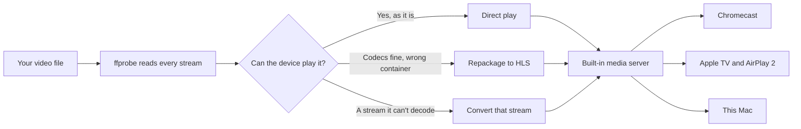

<p align="center">
  
</p>

<h1 align="center">Driftcast</h1>

<p align="center">
  <strong>Nearly any video on your Mac, on the biggest screen in the house.</strong><br>
  Chromecast. Apple TV. AirPlay 2 TVs. No waiting, and no conversion it doesn't need.
</p>

<p align="center">
  The free, open-source alternative to Airflow, Beamer, Elmedia Player, JustStream, Infuse and Plex<br>
  for playing MKV, AVI and any other video from your Mac on the TV.
</p>

<p align="center">
  <a href="https://github.com/leechsoftware/driftcast/releases/latest"></a>
  
  
  <a href="LICENSE"></a>
  
  <a href="https://github.com/leechsoftware/driftcast/releases"></a>
</p>

<p align="center">
  <a href="#where-it-plays">Devices</a> &nbsp;·&nbsp;
  <a href="#every-format-it-plays">Formats and codecs</a> &nbsp;·&nbsp;
  <a href="#supported-macos-versions-and-processors">macOS versions</a> &nbsp;·&nbsp;
  <a href="#gpu-first">GPU</a> &nbsp;·&nbsp;
  <a href="#subtitles-done-properly">Subtitles</a> &nbsp;·&nbsp;
  <a href="PRIVACY.md">Privacy</a> &nbsp;·&nbsp;
  <a href="#build-it-yourself">Build it</a>
</p>

<p align="center">
  <code>MKV</code> <code>MP4</code> <code>MOV</code> <code>AVI</code> <code>WMV</code> <code>WebM</code> <code>TS</code> <code>M2TS</code> <code>VOB</code> <code>MPEG</code> <code>FLV</code> <code>DivX</code> <code>RMVB</code> <code>MXF</code><br>
  <code>H.264</code> <code>HEVC</code> <code>AV1</code> <code>VP9</code> <code>VP8</code> <code>MPEG-2</code> <code>VC-1</code> <code>ProRes</code> <code>HDR10</code> <code>HLG</code> <code>Dolby Vision</code><br>
  <code>Dolby Atmos</code> <code>E-AC-3</code> <code>AC-3</code> <code>DTS-HD</code> <code>TrueHD</code> <code>FLAC</code> <code>ALAC</code> <code>AAC</code> <code>Opus</code>
</p>

---

## WHY?

Playing a video from your Mac on the TV shouldn't cost money, need an account, or turn into an evening of fiddling. Yet the apps people end up with all want something: **Airflow** and **Beamer** are paid apps with time-limited trials, **Elmedia Player** keeps casting behind its PRO upgrade, **JustStream** comes with a Setapp subscription, **Infuse** needs Infuse Pro before it will cast from a Mac, and **Plex** wants a media server installed and a library built before you can watch a single file. The free routes aren't much kinder: **VLC**'s Chromecast output is famously hit and miss, mirroring your screen or casting a **Chrome tab** re-encodes your whole desktop at whatever quality the Wi-Fi allows, and converting the file first with **HandBrake** means waiting for the conversion before you can press play.

Driftcast replaces all of that with one free app. Drop in an MKV, AVI, WMV, TS or almost anything else, pick your Chromecast, Apple TV or AirPlay 2 TV, and it works out what the device can play by itself: everything it can handle is passed through untouched, and only the stream it can't play is converted, on the GPU, while you watch. Subtitles arrive as real text, HDR and surround sound stay intact, the TV remote can skip through the real running time, and the poster and plot show up before the film starts. There's no account, no trial, no ads, no telemetry and nothing to install besides the app. It's GPL, so it stays free, and anyone can read every line of it.

| | **Driftcast** | Paid casting apps | Screen or tab mirroring | Plex or Jellyfin |
|---|---|---|---|---|
| Price | Free, open source | One-time purchase, subscription or trial | Free | Free core, with a server to run |
| Getting started | Open the file | Open the file | Start mirroring | Install a server, build a library |
| Picture on the TV | The original stream wherever possible | Varies | A re-encoded copy of your desktop | The original when the server allows |
| Subtitles | Real text tracks, any encoding, picture subtitles read as text | Varies | Burned into the mirror | Text tracks |
| Account | None | Some | None | Yes |

---

<table>
<tr>
<td width="33%" valign="top">

### Plays nearly anything

32 video file types, 7 audio file types, and every codec the bundled FFmpeg can decode. Drop a file on the window and press play.

</td>
<td width="33%" valign="top">

### Converts only what it must

Each stream is decided on its own. Playable video with unplayable sound converts the sound and leaves the picture untouched.

</td>
<td width="33%" valign="top">

### Runs on the GPU

Decoding, scaling, HDR tone mapping and encoding all stay in VideoToolbox. A 4K conversion uses about a thirtieth of the CPU time.

</td>
</tr>
<tr>
<td width="33%" valign="top">

### Starts right away

The device gets the complete playlist first, then conversion runs just ahead of it. You get the real duration and can seek with the TV remote.

</td>
<td width="33%" valign="top">

### Keeps HDR and surround

HDR10, HLG, Dolby Vision, Dolby Digital Plus and Atmos go through untouched wherever the device supports them.

</td>
<td width="33%" valign="top">

### Free, and stays free

No trial, no ads, no account and no tracking. Open source under the GPL, with FFmpeg already inside the app.

</td>
</tr>
</table>

## Why Driftcast

- **Direct play:** a file the device already reads is served untouched, with instant seeking.
- **Repackaging:** when only the container is wrong, such as HEVC in an MKV, the streams are copied into HLS with no quality loss and almost no processor time.
- **Conversion on demand:** only the streams the device can't decode are converted, while you watch.
- **Real seeking:** the whole playlist exists before conversion starts, so the device shows the true duration and its own remote can skip and scrub.
- **Poster and details first:** a five-second title card with the poster, title, year, cast and ratings before the film starts. You can switch it off.
- **Film and show details:** poster, plot, director, writers, cast, genres, age rating, running time and IMDb, Rotten Tomatoes and Metacritic scores, with no account needed.
- **Picture subtitles become text:** Blu-ray PGS and DVD VobSub are read on your Mac, so an HEVC film with PGS subtitles plays without converting the video.
- **A window that gets out of the way:** while casting, the video window shrinks to half size, dims the poster and shows who you're connected to, with play, pause and the timeline.
- **Updates itself:** Check for Updates downloads the new version, confirms it's signed by Leech Software, closes and reopens.
- **Nothing to install:** FFmpeg is inside the app. No Homebrew and no command line.

## Where it plays

- **Chromecast**, every generation, including Chromecast HD, Ultra, Chromecast with Google TV and Google TV Streamer
- **Nest Hub and Nest Hub Max**
- **TVs, soundbars and receivers** with Chromecast built in
- **Google speakers and speaker groups**, sound only, listed separately: Chromecast Audio, Google Home, Nest Audio, Nest Mini, JBL Link, Bose, Sony and other Cast speakers
- **Apple TV**
- **AirPlay 2 TVs** from Samsung, LG, Sony, Roku, Vizio, Hisense and others
- **This Mac**, in its own resizable window with picture-in-picture and full screen

Each device gets exactly what it can handle:

| Device | Largest picture | Video it plays as is | HDR |
|---|---|---|:-:|
| Apple TV, AirPlay 2 TVs, this Mac | 4K | H.264, HEVC | ✓ |
| Google TV Streamer | 4K | H.264, HEVC, VP9, AV1 | ✓ |
| Chromecast Ultra, Chromecast with Google TV, TVs with Cast built in | 4K | H.264 up to level 5.1, HEVC, VP9 | ✓ |
| Chromecast HD | 1080p | H.264 up to level 4.2, HEVC, VP9 | ✓ |
| Chromecast 1st to 3rd generation | 1080p at 30 fps, 720p at 60 fps | H.264 up to level 4.1, VP8 | – |
| Nest Hub, Nest Hub Max | 720p | H.264 up to level 4.1, VP9 | – |
| Cast speakers and groups | Sound only | – | – |

## Every format it plays

### File types

- **Modern:** MKV, MK3D, MP4, M4V, MOV, WebM, F4V
- **Disc and broadcast:** TS, M2TS, MTS, TP, TRP, VOB, MPG, MPEG, WTV, MXF
- **Classic:** AVI, DivX, WMV, ASF, FLV, RM, RMVB, OGV, OGM, 3GP, 3G2, DV
- **Raw video streams:** HEVC, H264, Y4M
- **Audio files:** MP3, M4A, FLAC, WAV, AAC, OGG, Opus

### Video codecs

| Codec | Apple devices | Chromecast |
|---|---|---|
| **H.264 / AVC**, 8-bit | Sent untouched | Sent untouched, within each model's level |
| **H.264**, 10-bit | Converted | Converted |
| **HEVC / H.265**, 8-bit and 10-bit | Sent untouched | Untouched on HD, Ultra, Google TV and Streamer, otherwise converted |
| **HDR10 and HLG** | Sent untouched | Untouched on HEVC models with HDR, otherwise tone-mapped to SDR |
| **Dolby Vision** | Sent untouched | Sent as HEVC to devices that report HDR |
| **AV1** | Converted | Untouched on Google TV Streamer, otherwise converted |
| **VP9** | Converted | Untouched on HD, Ultra, Google TV, Streamer and Nest Hub, otherwise converted |
| **VP8** | Converted | Untouched on 1st to 3rd generation, otherwise converted |

Converted to H.264 on every device, and all present as decoders in the bundled FFmpeg:

- **MPEG family:** MPEG-1, MPEG-2, MPEG-4 Part 2 (DivX, Xvid), H.263
- **Windows Media:** VC-1, WMV 1, 2 and 3, Microsoft MPEG-4
- **Professional and editing:** Apple ProRes, Avid DNxHD, DV, Motion JPEG, FFV1, HuffYUV
- **Web and legacy:** VP6, Sorenson Spark, Sorenson Video 3, RealVideo 1 to 4, Theora, Cinepak
- **Next generation:** H.266 / VVC
- **Anything else** FFmpeg decodes, plus pictures taller or faster than the device can manage

### Audio codecs

| Codec | Apple devices | Chromecast |
|---|---|---|
| **AAC**, **MP3**, **FLAC** | Sent untouched | Sent untouched (stereo) |
| **ALAC** | Sent untouched | Converted |
| **Opus** | Converted | Sent untouched (stereo) |
| **Dolby Digital** (AC-3) | Sent untouched | Untouched with "Pass through Dolby surround" on |
| **Dolby Digital Plus** (E-AC-3), including **Atmos** | Sent untouched | Untouched with "Pass through Dolby surround" on |
| **DTS, DTS-HD, DTS:X** | Dolby Digital Plus 5.1, FLAC or stereo | Stereo, or Dolby Digital Plus 5.1 with passthrough on |
| **Dolby TrueHD**, **MLP** | Dolby Digital Plus 5.1, FLAC or stereo | Stereo, or Dolby Digital Plus 5.1 with passthrough on |

Also converted, with decoders in the bundled FFmpeg:

- Vorbis, PCM (including Blu-ray and DVD PCM), ADPCM
- WMA 1, 2, Pro and Lossless
- MPEG audio layers 1 and 2, RealAudio Cook and Sipro
- Monkey's Audio, WavPack, TAK, AMR

Conversion produces **Dolby Digital Plus 5.1** (640 kbps), lossless **FLAC** up to 7.1, stereo **AAC** (192 kbps) or stereo **Opus** (160 kbps), as you choose in Settings.

### Tricky files it handles

- **Interlaced** DVD, broadcast and camcorder video is deinterlaced with bwdif
- **Rotated** phone video keeps its rotation
- **Transport streams** and recordings whose clock doesn't start at zero play and seek correctly
- **Dolby Vision profile 5** is labelled so devices recognise it
- **Frame rates above 60** are capped at 60, and **audio above 48 kHz** is resampled for AAC
- **Several audio tracks:** pick any of them, or let your preferred language choose
- **Volume booster**, **stereo downmix** and an **audio delay** of up to 2 seconds either way

## Supported macOS versions and processors

| macOS | Apple silicon | Intel |
|---|:-:|:-:|
| **macOS 26** Tahoe | ✓ | ✓ |
| **macOS 15** Sequoia | ✓ | ✓ |
| **macOS 14** Sonoma | ✓ | ✓ |
| **macOS 13** Ventura | ✓ | ✓ |
| macOS 12 Monterey and earlier | Not supported | Not supported |

- **One universal app:** native code for both processor types, with no Rosetta needed.
- **Apple silicon:** every M-series Mac.
- **Intel:** every Intel Mac that can run macOS 13 Ventura or later.
- **Self-contained:** static FFmpeg builds for each processor, with no third-party libraries to install.
- **Tested so far:** the automated checks pass natively on Apple silicon and as Intel code under Rosetta, on macOS 26. The app is compiled for macOS 13, but a real macOS 13 system and a real Intel Mac haven't been tried yet. If you have one, [please say how it went](https://github.com/leechsoftware/driftcast/issues).

## GPU first

- **Full GPU route:** VideoToolbox decodes, scales, tone-maps HDR and encodes H.264, so frames never come back to the CPU.
- **Measured:** converting the same 4K HEVC clip to 1080p H.264 took 6.45 s of CPU time with software decoding and scaling, and 0.19 s with the whole job on the GPU, in about the same elapsed time.
- **Steps down by itself:** if the GPU route won't start, the stream moves to hardware encoding only, then to x264 in software.
- **Only what needs the CPU uses it:** deinterlacing, drawn-in subtitles and rotated video do that one step in memory.
- **Paced to the player:** FFmpeg works about five minutes ahead, then is frozen until you catch up, so the Mac stays cool.
- **Light on your disk:** the temporary converted pieces are cleared from the system temp folder as you watch, so a long film never needs room for a full copy. Your own video files are never touched.

## Subtitles done properly

- **Text subtitles inside the file:** SRT, ASS/SSA, WebVTT, MOV text, MicroDVD, SubViewer, JACOsub, SAMI, RealText, STL, MPL2, PJS and VPlayer, sent as real text rather than drawn into the picture.
- **Subtitle files beside the video** are found automatically: `.srt`, `.ass`, `.ssa`, `.vtt`, `.smi`, `.sami`, with language and "forced" read from the name.
- **Picture subtitles become text:** Blu-ray PGS and DVD VobSub, in an MKV or as `.sup` and `.idx` files, are read with Apple's Vision framework and cached.
- **DVB and XSUB** picture subtitles are drawn into the video.
- **Any text encoding:** UTF-8, UTF-16 and UTF-32, or the legacy code page of the language, including Cyrillic, Greek, Turkish, Hebrew, Arabic, Thai, Vietnamese, Japanese, Chinese and Korean.
- **Find Subtitles Online:** search OpenSubtitles by exact file match and title, pick one, and it downloads and comes on. A free OpenSubtitles API key is required, and the app walks you through getting one.
- **Your rules:** always on, on only when the audio is in another language, or off. A forced track in your language counts.
- **Your size:** a slider in the Subtitles menu from 60% to 200%, applied on this Mac and on the Chromecast as you drag, and remembered between launches.
- **"I don't care about subtitles"** hides every notice about them.

## Playlists, playback and the rest

- Any number of named playlists, with drag and drop for files and folders
- Dropping several episodes of a show makes a playlist named after it, in episode order
- Resume where you left off, watched marks, a progress bar on every video and autoplay of the next one
- Right-click a video to remove it from the playlist, or to delete its file, which asks first and moves it to the Trash
- Hover and drag preview frames on the timeline, which work for MKV and AVI too
- Media keys and the Now Playing panel
- Keeps the Mac awake while serving a device
- Finds Chromecasts automatically and reconnects after a Wi-Fi dropout, resuming where it was
- Warns you when an AirPlay TV has connected but can't reach the Mac
- Every control is also a menu item, with keyboard shortcuts throughout

Everything the app does, in detail, is in **[docs/DESCRIPTION.md](docs/DESCRIPTION.md)**.

## How it works



| Folder | What's there |
|---|---|
| `Driftcast/Cast/` | Google Cast v2 over TLS, Bonjour discovery, the Default Media Receiver |
| `Driftcast/Media/` | ffprobe parsing, device profiles and the planner, FFmpeg HLS jobs, subtitle extraction, thumbnails |
| `Driftcast/Network/` | HTTP/1.1 server with byte ranges and CORS |
| `Driftcast/Playback/` | The queue, resume, tracks, media keys and the AVPlayer target |
| `Driftcast/Subtitles/` | The OpenSubtitles client and picture subtitle OCR |
| `Driftcast/Model/` | Playlists, watch progress, settings, updates |
| `Driftcast/Views/`, `Driftcast/App/` | SwiftUI windows, menus, Settings, About |

## Guides

- [How to cast MKV files to Chromecast from a Mac](https://leechsoftware.github.io/driftcast/how-to-cast-mkv-to-chromecast-from-mac/)
- [How to play MKV files on Apple TV from a Mac](https://leechsoftware.github.io/driftcast/play-mkv-on-apple-tv-from-mac/)
- [How to send any video from a Mac to a Samsung or LG TV](https://leechsoftware.github.io/driftcast/airplay-video-from-mac-to-samsung-lg-tv/)
- [How to get subtitles on Chromecast from a Mac](https://leechsoftware.github.io/driftcast/chromecast-subtitles-from-mac/)
- [How to play DTS audio on Chromecast from a Mac](https://leechsoftware.github.io/driftcast/dts-audio-chromecast-mac/)
- [How to cast 4K HDR video from a Mac](https://leechsoftware.github.io/driftcast/cast-4k-hdr-video-from-mac/)
- [A free Airflow alternative for Mac](https://leechsoftware.github.io/driftcast/free-airflow-alternative-for-mac/)

## Download

**[Get the latest release](https://github.com/leechsoftware/driftcast/releases/latest)**, unzip it and drag Driftcast to your Applications folder. Release builds are signed with a Developer ID and notarized by Apple.

You'll need macOS 13 Ventura or later, with your Mac and your device on the same network.

## Build it yourself

```sh
git clone https://github.com/leechsoftware/driftcast.git
cd driftcast
Scripts/bundle-ffmpeg.sh     # once: fetches the static universal FFmpeg, checksum-pinned
open Driftcast.xcodeproj     # Xcode 16 or later; pick your own team under Signing
Tests/run-harness.sh         # optional: the automated logic checks
```

Changes are welcome. See **[CONTRIBUTING.md](CONTRIBUTING.md)**.

## Testing status

- **AirPlay:** verified on a Samsung AirPlay 2 TV, including HEVC HDR10 with converted audio and subtitles.
- **Chromecast hardware:** not tried yet, because none was available during development. The protocol, playlists and per-model limits follow Google's documentation, and the streams were checked with AVPlayer standing in as the player. **If you own a Chromecast, a report, working or not, would help a lot.**
- **Side-loaded subtitles over HLS on Chromecast** are unconfirmed.
- **Dolby Vision profile 5 converted to H.264** can't be accurate, and the stream notes say so. Passed through, it's fine.
- **Dual-layer Dolby Vision** (profile 7) hasn't been tested.
- **Not included yet:** spatial audio virtualization, a phone remote and a network speed test.

## Privacy

- No account, no analytics, no ads and no crash reporting
- Your videos go only from your Mac to your device, over your own network
- Only a title and year go out for posters and details, and you can switch that off
- The full policy is in **[PRIVACY.md](PRIVACY.md)**

## License

Copyright (C) 2026 [Leech Software, Inc.](https://leechsoftware.com)

Driftcast is free software under the **GNU General Public License, version 3 or later**. See [LICENSE](LICENSE). It comes with no warranty.

[NOTICE.md](NOTICE.md) lists the software inside the app, including FFmpeg (GPL) and macSubtitleOCR (MIT), where its source code is, and the trademarks mentioned. Chromecast, Google TV, Apple TV, AirPlay, macOS, Dolby and DTS are trademarks of their owners. Driftcast and Leech Software are not affiliated with or endorsed by any of them.
